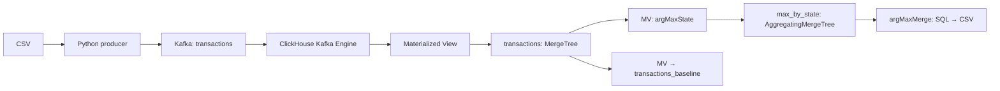

# ДЗ №2 · Kafka → ClickHouse

## Запуск

Нужны Docker Desktop / Engine, Compose v2.20+ и Python 3.9+.

```bash
python3 scripts/run.py smoke --reset
```

Demo проверяет загрузку, совпадение SQL с Python, отказ дублей и сохранность после рестарта.
**Проверено локально 12.10.2026:** `smoke --reset` завершился успешно, включая проверку после рестарта.

Скачайте [данные Kaggle](https://www.kaggle.com/t/1918f3f6435300327d38d6c596f97394),
положите `train.csv` и `test.csv` в `data/`:

```bash
python3 scripts/run.py full
```

Повторный запуск: добавьте `--reset` - **удалит данные выбранного стенда**.
Основной ClickHouse: `8123`, отдельный demo: `18123`.
Остановка: `docker compose down`; demo: `docker compose -p mts-dz2-smoke down`.

## Поток данных



`src/producer.py` выполняет п.1, DDL и запросы ниже - п.2-4.

| SQL-файл | Назначение |
|---|---|
| `sql/01_schema.sql` | DDL: Kafka Engine, постоянные таблицы и Materialized Views; оптимизированные типы, codecs, ключ и партиции |
| `sql/02_max_transaction_by_state.sql` | Основной запрос категории максимальной транзакции по штатам через `argMaxMerge` |
| `sql/03_baseline_query.sql` | Такой же запрос до оптимизации |
| `sql/04_optimized_raw_query.sql` | Полный скан оптимизированной исходной таблицы |
| `sql/05_max_transaction_for_dataset.sql` | Отчёт по одному CSV, фильтр по SHA-256 |
| `sql/06_dashboard_states.sql`, `sql/07_dashboard_categories.sql` | Данные для HTML-отчёта |

## Отдельный запуск producer

Альтернатива `full`/`load` на чистом стенде. Один CSV повторно не отправляйте.

```bash
docker compose build cli
docker compose up -d --wait --wait-timeout 240 kafka clickhouse
docker compose run --rm --entrypoint python cli -m src.producer --csv data/test.csv
```

## Результаты и оптимизация

1 048 575 транзакций, 50 штатов + DC. Основной результат -
[`results/max_transaction_by_state.csv`](results/max_transaction_by_state.csv), train+test.
[`results/max_transaction_by_state_test.csv`](results/max_transaction_by_state_test.csv) содержит только test.
Выбирается категория одной максимальной транзакции; при равных суммах - больший ID.

Замеры из [`results/benchmark.json`](results/benchmark.json): 5 прогретых запусков,
query cache выключен, ClickHouse 25.3.6.56. Время - медиана клиента с HTTP.

| Вариант | Время, мс | Прочитано строк | Размер на диске, МБ |
|---|---:|---:|---:|
| Baseline | 42.860 | 1 048 575 | 230.803 |
| Оптимизированная исходная таблица | 43.172 | 1 048 575 | 89.649 |
| Предагрегация | 2.826 | 51 | 0.004 |

Исходное хранилище уменьшилось **на 61%** благодаря LowCardinality и сжатию.
Запрос ускорился **в 15,2 раза** благодаря `AggregatingMergeTree` и
`argMaxState`/`argMaxMerge`: максимум считается при вставке, отчёт читает агрегатные состояния.
Сам полный скан raw быстрее не стал. Время и размеры зависят от машины и фоновых merge.

Повторить замеры:

```bash
docker compose run --rm cli benchmark --runs 5
```

## Доп

[HTML-отчёт](results/dashboard.html): поиск штатов, фильтры, детали транзакций,
распределение категорий и выгрузка CSV. Управление загрузкой и проверками - через Click CLI.

```bash
python3 scripts/run.py dashboard
docker compose run --rm cli --help
```
